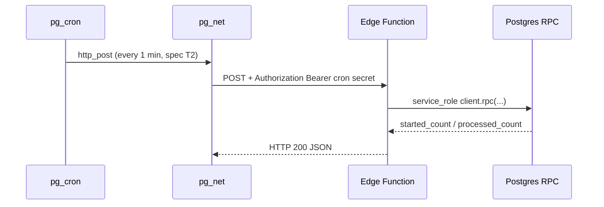

# Cron scheduler (process-auto-start / process-deadlines)

Design and runbook for periodic Edge invocation via pg_cron + pg_net + Vault on Supabase hosted, with local verification that does not require remote access.

## Architecture



Business logic stays in RPCs (`process_auto_start`, `process_deadlines`). Edge Functions are thin cron adapters (spec v6/v7 single-RPC pattern).

## Current contracts (code is source of truth)

| Layer | Name | Auth / caller | Success response |
| --- | --- | --- | --- |
| RPC | `process_auto_start()` | `GRANT` → `service_role` only | `integer` (rows started) |
| RPC | `process_deadlines()` | `GRANT` → `service_role` only | `integer` (challenges failed) |
| Edge | `process-auto-start` | `POST`, `Authorization: Bearer ${AUTO_START_CRON_SECRET}` | `{ "started_count": number }` |
| Edge | `process-deadlines` | `POST`, `Authorization: Bearer ${DEADLINES_CRON_SECRET \|\| AUTO_START_CRON_SECRET}` | `{ "processed_count": number }` |
| RPC | `process_point_expiry()` | `GRANT` → `service_role` only | `integer` (grant rows expired) |
| Edge | `process-point-expiry` | `POST`, `Authorization: Bearer ${POINT_EXPIRY_CRON_SECRET \|\| DEADLINES_CRON_SECRET \|\| AUTO_START_CRON_SECRET}` | `{ "expired_count": number }` |

Cron edges require `SUPABASE_SERVICE_ROLE_KEY` + `SUPABASE_URL` (injected on hosted; set locally for `functions serve`). RPC errors → HTTP `503` `{ "error_code": "temporary_unavailable" }`. Missing/wrong cron secret → `401`. **Remote `pg_cron` job for `process-point-expiry` is not scheduled yet — BLOCKED: USER APPROVAL REQUIRED** (same Vault/pg_net pattern as auto-start/deadlines).

Domain (decision A): `process_deadlines` only touches `IN_PROGRESS` challenges past `deadline`. `process_auto_start` only `WAITING` with `auto_start_at <= now()` and `deadline > now()`.

Schedule intent (spec): auto-start is **5 minutes after creation** (`auto_start_at`); cron **polls every 1 minute** (付録B T2) so start/FAILED can lag up to ~1 minute.

## Gaps (before production-like cron)

| # | Gap | Mitigation |
| --- | --- | --- |
| G1 | No `pg_cron` / `pg_net` enabled in migrations | Migration `20261008150000_cron_pg_extensions.sql` (extensions only) |
| G2 | No `cron.schedule` jobs | Remote SQL in checklist below — **BLOCKED: USER APPROVAL REQUIRED** |
| G3 | No Vault secrets for URL + bearer (pg_net path) | Dashboard / SQL — **BLOCKED** (no real values in repo) |
| G4 | Edge `verify_jwt` default `true` blocks Bearer cron secret | `supabase/config.toml` → `verify_jwt = false` for both cron functions; handler still checks cron secret |
| G5 | Remote `process-deadlines` not in last known deploy list | Include in deploy checklist |
| G6 | Spec ch.17 lists functions but not HTTP contract for cron edges | This doc + PROGRESS; optional spec appendix later |
| G7 | Local stack returns `404` for functions until served | Use `supabase functions serve` (see local verification) |

Alternative (Supabase docs): pg_net can send `apikey: <secret key>` with `verify_jwt = false` and no custom cron secret. This project intentionally uses a dedicated `AUTO_START_CRON_SECRET` in the handler.

## Local verification (no pg_cron required)

### Tier 1 — RPC (already in pgTAP)

`supabase db reset`; `supabase test db` runs `004_start_challenge`, `006`/`007_process_deadlines`, etc.

### Tier 2 — Edge unit tests

```powershell
cd supabase/functions/process-auto-start; deno test --allow-env
cd supabase/functions/process-deadlines; deno fmt .; deno test --allow-env
```

### Tier 3 — HTTP against local Edge

1. `supabase start`
2. Copy `supabase/functions/env.cron.example` → `supabase/functions/.env` (gitignored). Set `AUTO_START_CRON_SECRET` to a local-only value. `SUPABASE_SERVICE_ROLE_KEY` from `supabase status -o env`.
3. Serve functions (JWT verification off matches production cron config):

```powershell
supabase functions serve process-auto-start process-deadlines --no-verify-jwt --env-file supabase/functions/.env
```

4. Invoke:

```powershell
./supabase/scripts/invoke-cron-edge-local.ps1
```

### Tier 4 — pg_cron + pg_net locally (optional, after migration)

After `supabase db reset`, extensions `pg_cron` and `pg_net` are installed. Scheduling still needs a cron secret and URL in Vault; use Studio SQL editor locally with **placeholder** names only. Do not commit secrets. Full `cron.schedule` SQL is in the remote checklist (same shape works on local with `http://host.docker.internal:54321` or Kong URL from `supabase status`).

## Remote checklist — BLOCKED: USER APPROVAL REQUIRED

Do **not** run these until approved in chat.

### 1. Deploy config + functions

```powershell
supabase functions deploy process-auto-start --project-ref <PROJECT_REF>
supabase functions deploy process-deadlines --project-ref <PROJECT_REF>
```

`config.toml` must include `[functions.process-auto-start]` and `[functions.process-deadlines]` with `verify_jwt = false` (committed in repo).

### 2. Edge secrets (Dashboard → Edge Functions → Secrets or CLI)

```powershell
supabase secrets set --project-ref <PROJECT_REF> AUTO_START_CRON_SECRET=<generate-strong-secret>
# Optional separate secret:
# supabase secrets set --project-ref <PROJECT_REF> DEADLINES_CRON_SECRET=<generate-strong-secret>
```

`SUPABASE_URL` and `SUPABASE_SERVICE_ROLE_KEY` are provided by the platform to Edge; do not set service_role from Flutter.

### 3. Push DB migration (extensions only)

```powershell
supabase db push --project-ref <PROJECT_REF>
```

Review dry-run first:

```powershell
supabase db push --project-ref <PROJECT_REF> --dry-run
```

### 4. Vault (SQL Editor — replace placeholders, do not paste into git)

Store project API URL and the **same** bearer value as `AUTO_START_CRON_SECRET` (or separate deadlines secret).

```sql
-- Example names only; use Dashboard Vault UI or approved SQL.
select vault.create_secret('https://<PROJECT_REF>.supabase.co', 'project_url');
select vault.create_secret('<AUTO_START_CRON_SECRET>', 'cron_bearer_auto_start');
-- Optional: select vault.create_secret('<DEADLINES_CRON_SECRET>', 'cron_bearer_deadlines');
```

### 5. Schedule jobs (1-minute cadence, spec T2)

```sql
select cron.schedule(
  'process-auto-start-every-minute',
  '* * * * *',
  $$
  select net.http_post(
    url := (select decrypted_secret from vault.decrypted_secrets where name = 'project_url')
           || '/functions/v1/process-auto-start',
    headers := jsonb_build_object(
      'Content-Type', 'application/json',
      'Authorization', 'Bearer ' || (select decrypted_secret from vault.decrypted_secrets where name = 'cron_bearer_auto_start')
    ),
    body := '{}'::jsonb
  ) as request_id;
  $$
);

select cron.schedule(
  'process-deadlines-every-minute',
  '* * * * *',
  $$
  select net.http_post(
    url := (select decrypted_secret from vault.decrypted_secrets where name = 'project_url')
           || '/functions/v1/process-deadlines',
    headers := jsonb_build_object(
      'Content-Type', 'application/json',
      'Authorization', 'Bearer ' || coalesce(
        (select decrypted_secret from vault.decrypted_secrets where name = 'cron_bearer_deadlines'),
        (select decrypted_secret from vault.decrypted_secrets where name = 'cron_bearer_auto_start')
      )
    ),
    body := '{}'::jsonb
  ) as request_id;
  $$
);
```

### 6. Verify (read-only)

- Edge logs: invocations every minute, HTTP 200, non-zero counts when test data exists.
- `select * from cron.job;` and `cron.job_run_details` for failures.
- pg_net: `select * from net._http_response order by created desc limit 5;` (if available).

### 7. Rollback (approval required)

```sql
select cron.unschedule('process-auto-start-every-minute');
select cron.unschedule('process-deadlines-every-minute');
```

## References

- `docs/spec.md` 付録B T2 (1-minute cron granularity)
- `docs/spec.md` 変更記録 v7 (`process-auto-start`, remote cron deferred)
- Migrations: `20261006140000_start_challenge.sql`, `20261007074759_process_deadlines_lock_order.sql`
